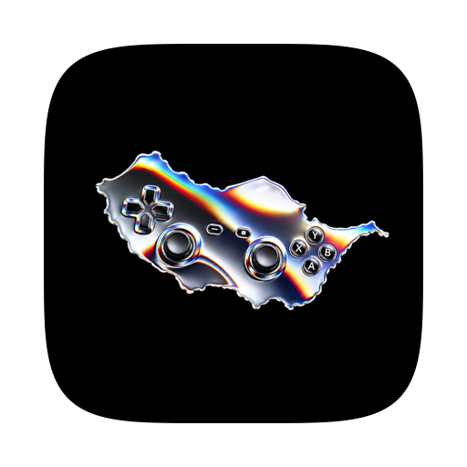
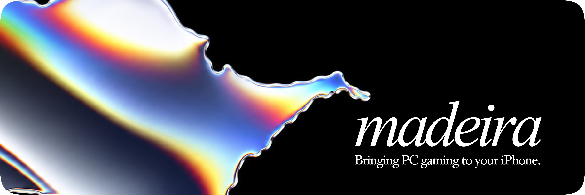

<div align="center">



# Madeira

**Windows PC games on iPhone and iPad, with no jailbreak**


</div>

---

## Overview

This is my fork of [willfaust/Madeira](https://github.com/willfaust/Madeira), which runs
unmodified Windows games inside a single iOS app. The fork tracks upstream and adds Epic Games,
a Store, iPad support, a SteamOS-style interface, a rebuilt touch-control editor, Vulkan games,
and a long list of runtime and performance fixes that get more games running, and running faster.

## What this fork adds

| Area | Changes |
|---|---|
| **Epic Games** | In-app sign-in, your owned library with catalog titles, artwork and store screenshots, and a native installer ported from [Legendary](https://github.com/derrod/legendary): manifests, chunked downloads with resume and pause, CDN fallback, uninstall, and launching with an exchange code. Downloads fetch 16 chunks ahead across files, so games made of many small files no longer crawl |
| **Store** | Browse Steam and Epic from one Store tab: shelves built from Steam's ranked lists and filtered to well-reviewed games, review bars, trailers with sound, screenshots, and prices |
| **Steam** | Add any game by App ID or store link (free licenses are requested for you), DLC and Workshop sync, Cloud saves always over HTTPS, and 16 parallel chunk downloads |
| **One library** | Steam, Epic and added games together, split into Installed and Not installed, with store filters, install sizes and free space shown before you download, a disk cache for artwork, and download state as a status line that keeps your scroll position |
| **Interface** | SteamOS-style layout built from native glass parts: a black side menu that fades into the page, store-style game pages, a grouped in-game menu, swipe-to-log-out accounts, and an optional glow behind installed games. The whole interface works with a controller: the stick or D-pad moves a soft highlight that stays in view, A/B/Y act, LB/RB switch sections and land on the first game, store or setting, and Settings goes row by row |
| **iPad** | Runs on iPadOS 26: no `pipe2`, a FEX band that fits the iPad's address space, and 32-bit DXMT built for Metal 3.1, so Half-Life 2 and Portal 2 work |
| **Touch controls** | Rebuilt editor with a docked inspector, snapping, undo and a drawn keyboard; WASD, arrow-key and platformer presets; a mouse-look pad; one global on-screen layout with working opacity |
| **Controllers and input** | Player 1 is an Xbox 360 pad on XInput and as a HID device, so DirectInput, raw HID, SDL, Unity and Rewired games all find it; mouse wheel support; a trackpad or mouse pointer kept inside the game (a virtual cursor, raw movement for mouse look; released by the in-game menu); touches mapped into windowed games; keyboard input that finds the game window; and pointer lock for mouse look in Dock sessions |
| **Vulkan games** | Vulkan through MoltenVK with persistent per-game pipeline caches, an in-memory pipeline cache for pipelines a game recreates, optional background pipeline compiling (`MVK_MADEIRA_ASYNC_PIPELINES`: no freezes on first-seen shaders), reuse of compiled shaders, precompiled shader libraries, fixed fragment-output conversion, a pipeline-cache shadow and a fix for a GPU ordering race (`MVK_MADEIRA_FULL_BARRIERS`) that blurred faces in depth of field. Detroit: Become Human runs at about 55-60 fps on an M5 iPad |
| **Performance** | Direct3D 9 vertex and index buffers read straight from game memory (Borderlands: The Pre-Sequel went from 6–15 fps to its 30 fps cap), a 14x cheaper x86-to-Windows call path in FEX (a per-call shared lookup replaced by a read-only cache), smarter dynamic-buffer reuse in DXMT (Talos Principle, What Remains of Edith Finch), a semaphore fast path, adaptive yielding that doesn't oversleep, and less CPU work per Vulkan submit |
| **Memory** | A swap tier that moves cold game memory to storage once a game gets big, automatic texture downscaling near the iOS memory limit, and lean address-space reservations, so games that used to be killed at 6 GB keep running |
| **Runtime** | Store emulation on JIT-alias pages (page-straddling stores, exclusives, LSE and misaligned atomics), cooperative WoW64 thread suspend that fixes Mono garbage-collector hangs (Terraria), Wine Mono for .NET games, OpenGL through Mesa Zink and MoltenVK, FAudio 26.10, a `windows.gaming.input` deadlock fix, Direct3D 9 fixes (Super Meat Boy), and missing apiset DLLs |
| **Quality of life** | Quit closes the game, or ends a Desktop or Dock session and returns to the library; 16:9, 16:10 and 4:3 display modes at the screen's height; game sound comes back after a phone call or other audio interruption; a JIT progress overlay; the game's console window captured into its log; and a one-file `madeira.cfg` for every switch |
| **Diagnostics** | A frame-time, GPU and CPU report every 5 seconds, per-thread time split across game, Wine, FEX (down to its functions), DXMT and Metal, thermal and Low Power Mode logging, and a one-frame MoltenVK dump of every render pass with each draw's inputs and shaders for tracking down rendering bugs (`tools/mvk-dump-*`) |

Everything upstream does is still here: Steam sign-in, downloads and Cloud saves, Madeira Dock
(Valve's Windows Steam client), Bluetooth controllers, keyboard, mouse and trackpad, and video
and audio for cutscenes.

## How it works

| Layer | What it does |
|---|---|
| **[FEX-Emu](https://github.com/FEX-Emu/FEX)** | Translates the game's x86 and x86-64 code to ARM64 as it runs |
| **[Wine](https://www.winehq.org/)** | Provides Windows, built for ARM64EC so only the game's own code is translated; 32-bit games run through WoW64 |
| **[DXMT](https://github.com/3Shain/DXMT)** | Draws Direct3D 9, 10 and 11 with Metal |
| **[MoltenVK](https://github.com/KhronosGroup/MoltenVK)** | Runs Vulkan games on Metal, and OpenGL games through [Mesa](https://www.mesa3d.org/) Zink |
| **[madeira-d3d12](madeira-d3d12)** | Direct3D 12 on Metal, converting DXIL shaders with Apple's Metal Shader Converter |

iOS apps can't start other programs, so everything runs in one process, Wine's server included.

## Installing

| | |
|---|---|
| **Device** | iPhone on iOS 26 or later, or iPad on iPadOS 26 |
| **JIT** | Needs a debugger attached; [StikDebug](https://github.com/StikDebug/StikDebug) or the built-in setup ([JIT setup](docs/JIT.md)) |
| **Signing** | Any Apple ID; free accounts need re-signing every 7 days, and games and saves survive reinstalls |

1. Download the IPA from the [latest release](https://github.com/iediot/Madeira/releases).
2. Sideload it with SideStore, AltStore, Sideloadly, Plume or similar.
3. Open Madeira, enable JIT, and sign in to Steam or Epic under **Accounts**.

## Building

```sh
git clone --recurse-submodules https://github.com/iediot/Madeira.git
```

FEX, Wine and DXMT are pinned to public forks under `iediot` containing this fork's
complete source changes; FEX's nested rpmalloc dependency is public there too. Madeira Dock
uses its pinned public upstream source. A recursive clone fetches these sources without
access to this development machine. Matching patch snapshots and the MoltenVK changes are
also in [`patches/`](patches); do not reapply a snapshot to a submodule that already contains it.
Building still requires the toolchains and native-library steps in
[`docs/BUILDING.md`](docs/BUILDING.md), not just opening Xcode after cloning.

| Path | Contents |
|---|---|
| [`app/`](app) | The iOS app: SwiftUI front end, Wine bridge, Steam and Epic clients |
| [`build/`](build) | Build scripts and iOS-side sources, one folder per component |
| [`patches/`](patches) | This fork's FEX, DXMT, MoltenVK and Wine changes |
| [`tests/`](tests) | Host checks and x86, x86-64 and DXMT test programs |
| [`tools/`](tools) | Device helpers, including the MoltenVK frame dump |
| [`docs/`](docs) | [Library](docs/LIBRARY.md), [Epic](docs/EPIC.md), [Steam](docs/STEAM_LIBRARY.md), [controllers](docs/CONTROLLERS.md), [keyboard and mouse](docs/KEYBOARD_MOUSE.md), [WoW64](docs/WOW64.md) and more |

## Credits

Madeira was created by **Will Faust** ([@willfaust](https://github.com/willfaust)), with
**[@125hz](https://github.com/125hz)**, **[@Jfishin](https://github.com/Jfishin)**,
**[@JesseLovelace](https://github.com/JesseLovelace)**, **[@danperks](https://github.com/danperks)**,
**[@bahacan16](https://github.com/bahacan16)**, **[@spitefulowl](https://github.com/spitefulowl)**, **[@meshoklv](https://github.com/meshoklv)** and **[@TheHadesc](https://github.com/TheHadesc)**.
This fork also carries fixes from the forks of llucasandersen, x3gamer10, vcvkk, c-gow,
dre4moff, jakub, kinivi, spitefulowl and solluxcaptor429, and from upstream pull requests.

Built on [Wine](https://www.winehq.org/), [FEX-Emu](https://github.com/FEX-Emu/FEX),
[DXMT](https://github.com/3Shain/DXMT), [MoltenVK](https://github.com/KhronosGroup/MoltenVK),
[Mesa](https://www.mesa3d.org/), [FAudio](https://github.com/FNA-XNA/FAudio), [rpmalloc](https://github.com/mjansson/rpmalloc),
[Legendary](https://github.com/derrod/legendary) and [StikDebug](https://github.com/StikDebug/StikDebug).

## License

GPL-3.0-or-later ([`LICENSE`](LICENSE)) with the Madeira Converter Exception
([`LICENSE-EXCEPTION.md`](LICENSE-EXCEPTION.md)). Component licenses are in
[`docs/LICENSING.md`](docs/LICENSING.md) and [`THIRD-PARTY-NOTICES.md`](THIRD-PARTY-NOTICES.md).
Microsoft's Visual C++ runtime is not included.

<p align="center">
  
</p>
